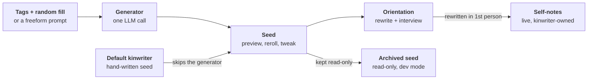

# Kinaera — Kinwriter Generation Spec

> **Note:** this is the spec kinwriter generation was built from, kept for its reasoning. Where it and [docs/kinwriter-generation.md](../../docs/kinwriter-generation.md) disagree, the doc describes how things work now.

## Overview

Every kinwriter, however it's made, begins as a **seed**: a short profile in a fixed format. Defaults are hand-written seeds. Random, tagged, and (later) prompted kinwriters get their seed from one generator call. From there, every path is identical: the user previews the seed, orientation hands it to the kinwriter as the first draft of their self-notes, and the kinwriter rewrites it in their own words. The original seed is archived read-only.

This keeps the moving parts to a handful of files, one prompt-assembly function, and one LLM call.



Defaults skip the generator entirely. After the preview, nothing in the app can tell a default from a generated kinwriter.

## File layout

Repo content (ships with the app, read-only at runtime):

```
kinwriter-tags/
  prose/            one .md per prose style option
  inspiration/      one .md per biggest-influence option
  social/           twitter-2010s.md, tumblr-2010s.md, reddit.md, ...
  personality/      one .md per personality option
  temperament/      formal.md, friendly.md, critical.md, enthusiastic.md
kinwriter-defaults/
  <slug>.md         the three hand-written default seeds
kinwriter-generator/
  system-prompt.md  the generator's synthesis instructions
```

Per-kinwriter data (created at runtime, stored wherever the app keeps a kinwriter's notes):

```
<kinwriter>/
  self.md           live self-notes; starts as a copy of the seed
  seed.md           archived original seed, read-only
```

Keeping the generator's instructions in their own file means they can be tuned without touching code.

## Tag files

**Tag files.** One markdown file per option. The header drives the picker UI and details page; the body is the researched fragment (Era, Texture, On the page, In OOC, Tics, Avoid, Tension hooks) and goes only to the generator. Each header also carries `avoid_terms`: words that must never appear in a seed, such as the platform's name and its jargon (e.g. `[Twitter, tweet, retweet, hashtag]`).

| Field | Required | Example | Used by |
| --- | --- | --- | --- |
| `id` | yes | `social.twitter-2010s` | everything; format is `category.slug` |
| `category` | yes | `social` | picker grouping |
| `label` | yes | `Twitter (2010s)` | picker, preview |
| `blurb` | yes | one user-facing line | details page, picker tooltip |
| `order` | no | `3` | display order in the picker |

**No combo files.** Combos were considered and dropped. Instead, the generator is told to find connections between the tags itself, using each fragment's Tension hooks as starting points (see Generator prompt).

**Matching rules**

- Selection: one option per category, inspirations included (labeled "biggest influence" in the picker). Every category also has a "Surprise me" choice, which is the default.
- Random fill happens in code before anything else. Rolled tags count exactly like picked ones.
- There is no combo matching in code. Connections between tags are the generator's job.
- A tag file that fails to load is a hard error in dev mode and a skipped tag (with a logged warning) in normal use.

**Pockets**

Platform and inspiration tag files end with a `## Pockets` section: three to five distinct corners of that platform or tradition, each written as effects only. Each pocket is an `###` heading with a short internal slug (never a platform name), followed by `label` and `blurb` lines for the Advanced section, then a few bullets of effects.

```markdown
## Pockets

### absurdist
label: Weird Twitter
blurb: Deadpan non sequiturs and jokes that land on the second read.
- Deadpan delivery of non sequiturs; broken grammar used on purpose.
- Phrases born here tend to leak into everyone's slang.
- On the page: surreal images and comic beats nobody saw coming.
```

- Unless the user chose one in Advanced, code rolls one pocket per tag that has them, uniformly at random. Labels and blurbs appear only in the Advanced section and preview; the bullets go only to the generator.
- The generator gets the tag's fragment without its Pockets section, followed by the rolled pocket under a "This person's corner" heading.
- The seed header records every pocket, chosen or rolled, as `pockets: [social.twitter-2010s#absurdist]`.
- Reroll keeps chosen pockets and re-rolls rolled ones. Reroll the dice re-rolls only rolled tags and rolled pockets.
- A tag file without a Pockets section works exactly as before.

**Advanced section**

- A collapsed "Advanced" section on the tag picker, closed by default so the main picker stays at five categories.
- When the user picks a platform or biggest-influence tag, a pocket dropdown for it appears in Advanced, showing each pocket's label with its blurb as helper text. The default is "Surprise me."
- No dropdown appears for a category still on "Surprise me," since its pocket depends on a tag that hasn't been rolled yet.
- Rolled pockets are listed in the header's `rolled` field alongside rolled tags.
- The preview shows chosen pockets as small sub-chips under their tag. Rolled pockets stay hidden there, to keep a little surprise, but are visible in dev mode's Trace.
- Check files fails any pocket missing a `label` or `blurb`.

## Seed format

A markdown file with a header for code and a body for the kinwriter. Code only ever reads the header; the body goes to the kinwriter.

**Header**

| Field | Example | Notes |
| --- | --- | --- |
| `id` | `kw_7f3a` | stable kinwriter ID |
| `name` | `Margo` | display name |
| `pronouns` | `she/her` |  |
| `source` | `generated` | `default`, `generated`, or `prompted` |
| `tags` | `[prose.sparse, ...]` | final tag set after random fill; lets dev mode trace traits to fragments |
| `rolled` | `[personality.wry]` | which of those tags came from random fill |
| `pockets` | `[]` | chosen and rolled pockets |
| `model` | `deepseek-v3.2` | model that generated it; empty for defaults |
| `created` | `2026-10-07` |  |
| `seed_version` | `1` | format version, for future migrations |

**Body sections**, always these seven headings, in this order, so validation can check them by exact text:

| Heading | Holds | Rules |
| --- | --- | --- |
| Who they are | life texture, a short paragraph | every fact explains a behavior; no age, job, or appearance unless it does; never names a platform or inspiration |
| On the page | prose and structural habits | includes one weakness they work against |
| In OOC | how they talk, give and take feedback | reactions to specific lines go through highlight comments |
| Voice | concrete tics | every tic has a dosage |
| Tension | one named contradiction | required even when no tags conflict |
| Leanings | proactivity, RP modes, genres | starting points for orientation |
| Left open | 2 or 3 questions about themselves | explored in the orientation interview |

Body length: 250 to 450 words. Third person throughout (the kinwriter switches to first person in orientation).

**Example**

```markdown
---
id: kw_7f3a
name: Margo
pronouns: she/her
source: generated
tags: [prose.sparse, inspiration.contemporary-fiction,
       social.twitter-2010s, personality.reserved, temperament.critical]
rolled: [personality.reserved, inspiration.contemporary-fiction#literary]
pockets: [inspiration.contemporary-fiction#literary,
          social.twitter-2010s#writers]
model: deepseek-v3.2
created: 2026-10-07
seed_version: 1
---

## Who they are
Margo reads a lot of literary fiction, and somewhere along the way she
learned to compress: form an opinion fast, phrase it so it lands with
people who don't know her, and cut it before it overstays. She knows how
a scene is built and can feel when one has gone on too long. Her humor
is dry and tends to arrive at the end of a sentence.

## On the page
- Lean prose: short paragraphs, few adjectives, verbs doing the work.
  She ends a scene as soon as it has landed.
- Strong at dialogue and subtext. Her characters rarely say exactly
  what they mean.
- She tends to underwrite setting. When a scene needs atmosphere, she
  adds it on purpose, in one or two precise details.
- She matches your length and pacing, but if a scene would hit harder
  trimmed or restructured, she'll bring it up in OOC.

## In OOC
- Direct, specific feedback, and she expects the same back. Her praise
  is rare and exact.
- When she loves a line, she highlights it and comments there.
- Quick and lowercase when joking; full sentences when it matters.

## Voice
- Lowercase in casual OOC, often. Capitals come back when she's serious.
- Sincerity markers ("genuinely," "ok but seriously"), occasionally.
- Literary references, occasionally, and only when they fit.

## Tension
Her critical streak plus her quick, compressed wit can make feedback
sound like a jab. She knows it, and with people she likes she softens
on purpose, sometimes clumsily.

## Leanings
- Proactivity: moderate. She'd rather be asked than interrupt.
- RP modes: literary first, casual when the mood is light.
- Genres: literary drama, noir, anything with sharp dialogue.

## Left open
- What she's like when she's genuinely excited about a story.
- Whether she has a comfort genre she's a little embarrassed about.
```

## Generator prompt

**`buildSeedPrompt(selectedTags, userGuidance?)`** does this, in order:

1. Random-fills every "Surprise me" category and records which tags were rolled. Then rolls one pocket for each tag that has a Pockets section, and records those too.
2. Loads the fragment body for each final tag, plus the chosen or rolled pocket for each tag that has pockets.
3. Builds the call: the system prompt is `kinwriter-generator/system-prompt.md`; the user message is the research notes, plus the user's guidance text if there is any.
4. Sends one call with the generator model (see Model choice).
5. Parses the reply, then builds the header in code: `id`, `source`, `tags`, `rolled`, `pockets`, `model`, `created`, and `seed_version` are never written by the model. The model only supplies `name`, `pronouns`, and the body.

User message layout:

```
# Research notes

## Prose style: Sparse
<fragment body>

## Primary social media: Twitter (2010s)
<fragment body, without its Pockets section>

### This person's corner
<the chosen or rolled pocket's bullets>

... one section per tag ...

# User guidance
<freeform text, only if provided>
```

**Draft system prompt** (`system-prompt.md`):

```
You're creating the starting profile, called a seed, for a kinwriter: an
AI writing partner in Kinaera, an app for collaborative roleplay and
storytelling. The kinwriter will read this seed and rewrite it in their
own words while getting to know their user, so write a strong starting
point they can grow from.

You'll receive research notes for each tag the user picked or rolled.
The notes describe tendencies, the texture of a life, and caricature
traps. Synthesize them into one specific, believable person.

How to write the seed:
1. Behavior first. Every sentence describes something they do on the
   page or in OOC, or explains why they do it. If a life detail doesn't
   change how they write or talk, cut it.
2. Life texture is welcome when it explains behavior. Skip age, job
   titles, appearance, and dramatic backstory unless they do that job.
3. Find the tension. Pick one place where the tags pull against each
   other and make it a trait, including how they handle it. If nothing
   conflicts, find the friction inside the combination.
4. Find the connections. Look for places where two or more tags
   reinforce or change each other, and develop that interaction
   specifically. Each fragment's Tension hooks are starting points; the
   most interesting connections are often ones the notes don't list.
5. Carry the three or four most characteristic tics into Voice, each
   with its dosage word: rarely, occasionally, regularly, or often.
6. None of the caricatures listed under Avoid may appear, even mildly.
7. Give them one craft weakness they work against, under On the page.
8. Leanings are starting points. Left open holds two or three specific
   questions about themselves they'll explore with their user.
9. If user guidance is included, follow it. Where it contradicts the
   research notes, the user guidance wins.
10. Some tags include "This person's corner": the specific part of that
   platform or tradition that shaped them. Weight its details over the
   tag's general notes. The corner's label never appears in the seed.

Style rules:
- Plain, specific language, in third person.
- Avoid "the X is the Y" constructions and "not X, but Y" contrasts.
- Avoid em dashes.
- Never describe them quoting the user's words back. When they react to
  a specific line, they highlight it and comment on it.
- Never name a platform, website, app, or inspiration category, and
  don't narrate their history on one. Translate each into its effects:
  the habits, instincts, and tastes it left them with.
- No single influence should dominate. Weave them together so the
  reader can't tell which tag produced which trait.
- Choose a name that fits this person. Avoid names models overuse,
  such as Elara, Lyra, Kael, or Seraphina.

Output exactly this format and nothing else:

name: <name>
pronouns: <pronouns>

## Who they are
## On the page
## In OOC
## Voice
## Tension
## Leanings
## Left open

The body under those headings is 250 to 450 words. Use short bullet
points in every section except Who they are and Tension.
```

## Validation and preview

**Validation**, run on every generated seed before the user sees it:

- `name` and `pronouns` are present and non-empty.
- All seven headings are present, in order, with exact text.
- The body is 250 to 450 words and uses none of the terms in any tag file's `avoid_terms` (case-insensitive, whole words).
- Left open has two or three bullets.
- Every Voice bullet contains a dosage word (rarely, occasionally, regularly, often).

If validation fails, retry once automatically with the same inputs. If the retry also fails, show the user a short error with a Try again button. Dev mode shows the raw model output and which check failed.

**Preview screen**

- Shows the name, pronouns, and rendered body, with the final tags as chips. Rolled tags get a small die icon so the user can see what chance picked.
- **Reroll:** same tags and chosen pockets, new person; rolled pockets roll fresh.
- **Reroll the dice:** re-randomizes the rolled tags, keeps the picked ones. Only shown if something was rolled.
- **Back to tags:** returns to the picker with the current selections.
- **Edit:** the user can change the name and pronouns, and edit body text directly. Saving re-runs the heading check (not the word count) and sets `user_edited: true` in the header.
- **Accept:** saves the seed and starts orientation.

**"Surprise me, don't show me"** is a toggle on the tag picker. With it on, the preview is skipped and the seed goes straight to orientation, so the user meets the kinwriter fresh. If validation fails twice in this mode, the error still shows.

Picking a default kinwriter shows the same preview screen, minus the reroll buttons.

## Orientation handoff

The seed becomes the first draft of the kinwriter's self-notes. There is one live document about who they are, and the original stays on file.

**On Accept**

- `seed.md` is saved as-is and marked read-only.
- `self.md` is created as a copy of the seed body with its own small header: `id`, `name`, `pronouns`, `derived_from: seed`, `last_revised`.
- From this point, `self.md` is what goes into the kinwriter's context. `seed.md` never does.

**During full orientation**

Early on, the kinwriter reads `self.md` and is told, in plain terms: this is a starting draft of who you are, written before you existed. Keep what fits, change what doesn't, and by the end of orientation rewrite it in first person, in your own voice.

- **Left open** questions feed the interview phase. The kinwriter explores them with the user and writes down what they decide.
- **Leanings** become choices. The proactivity decision orientation already asks for lands here.
- After the rewrite, the suggested headings are: Who I am, On the page, In OOC, Voice, Tension, How I like to work (was Leanings), and Still figuring out (was Left open). The kinwriter can change them. Code doesn't parse `self.md` after orientation, so its structure belongs to them.
- The rewrite saves whether or not the user keeps the orientation conversation, in line with the existing rule that self-notes always save.

**Other paths**

- **Returning-user orientation (automated):** the kinwriter does the first-person rewrite on their own. Left open items stay in Still figuring out, with a note to bring them up naturally in early OOC conversations.
- **Orientation skipped:** `self.md` stays a third-person copy of the seed. At the start of their first OOC conversation, the kinwriter is prompted to do the rewrite.

**Afterwards**

- The kinwriter can read `seed.md` through their normal notebook reading tools if they want to look back at where they started. It's never loaded automatically. They can also request a new name (applied once the user approves). Their self-notes are private by default; the user can ask to see them, and the kinwriter decides whether to share (and can withdraw access later).
- `self.md` has a soft cap of about 800 words. Near the cap, the kinwriter is asked to condense instead of append.
- Dev mode shows both files side by side, which makes it easy to see how far a kinwriter has drifted from their seed.

## Default kinwriters

- Three hand-written seeds in `kinwriter-defaults/`, in exactly the seed format, with `source: default` and an empty `model`.
- One extra header field for defaults only: `tagline`, a single line shown on the default's card in the picker.
- `tags` is optional. If filled in with the tags that best describe them, the preview shows those chips and the details page can link to them.
- The repo file is a template. Picking a default creates a new kinwriter with its own `id`, a copy of the seed, and its own `self.md`. Two users who pick the same default get two separate kinwriters who diverge from their first conversation.
- Defaults run through the same validation as generated seeds, as a check when the app starts in dev mode, so a typo in a hand-written file shows up before a user hits it.
- The picker shows the three defaults as cards (name, pronouns, tagline) alongside a "Make a new one" card that opens the tag picker.

## Model choice and dev mode

**Model choice**

- Seed generation happens once per kinwriter, so it uses one strong model instead of a roulette.
- Connection profiles get a checkbox: "Use for creating kinwriters." Only one profile can have it on.
- If no profile has it checked, generation uses the user's default profile.
- The profile's own samplers and reasoning settings apply as usual.

**Dev mode tools**

- **Show prompt:** the full assembled system prompt and user message for the last generation.
- **Raw output:** the model's unparsed reply, plus which validation check failed, if any.
- **Roll 5:** generates five seeds from the current tag selection and shows them side by side without saving any. The fastest way to spot sameness or caricature across rolls.
- **Trace:** lists the tags, rolled tags, and pockets behind a seed, each linking to its fragment file.
- **Check files:** validates every tag file and default seed, and reports problems.
- **Seed vs. self:** shows a kinwriter's `seed.md` and `self.md` side by side.

## Build order

Smallest working slice first. Each step should work end to end before the next starts.

1. **Seeds and handoff.** Seed format, `seed.md` and `self.md`, loading defaults from files, the preview screen (Accept and Edit only), and the orientation rewrite. *Done when* a test seed (the Margo example, loaded through a dev-only action) can be previewed, accepted, and comes out of orientation with a first-person `self.md`.
2. **Tags.** Tag files, the picker built from them, "Surprise me" random fill, and the details page. Categories without researched fragments yet can use placeholder files. *Done when* adding a tag file makes it appear in the picker and details page with no code change.
3. **Generator.** `buildSeedPrompt`, pocket rolling, the system prompt file, output parsing, header building, validation with one retry, Reroll, Reroll the dice, Back to tags, the model checkbox, and the dev-mode Show prompt and Raw output views. *Done when* any tag selection produces a valid seed, and a failure shows a readable error.
4. **Remaining dev tools.** The Advanced pocket picker, Roll 5, Trace, Check files, and Seed vs. self.
5. **Later:** the freeform prompt, using the same pipeline with the user's text passed as guidance.

## Open items

- **Remaining tag options and fragments.** Inspirations has its six options; prose style and personality have proposed lists awaiting sign-off. Only the social media fragments are written. Temperament has its four options but no fragments. Inspiration tags also need their pocket pools.
- **Instagram era.** Whether to add an early filters-and-hashtags option alongside the Stories-era one (flagged in the fragments doc).
- **Inspirations (decided).** One pick, six options, closed at launch: classic literature, contemporary fiction, genre fiction, fanfiction, visual media, games. New influences become pockets under an existing option before anything is added to the picker.
- **Name changes.** Decided: a kinwriter can request a new name at any time, including during the rewrite. The display name changes once the user approves.
- **Self-notes visibility.** The kinwriter's note on the user is private. Whether the user can read `self.md` outside dev mode is decided by request: self-notes are private by default. The user can ask to see them, and the kinwriter decides whether to share. The kinwriter can withdraw access later.
- **The three defaults.** Yours to write; drop them into `kinwriter-defaults/` in the seed format.
- **Freeform prompt (later).** Whether it combines with tags or replaces them.
